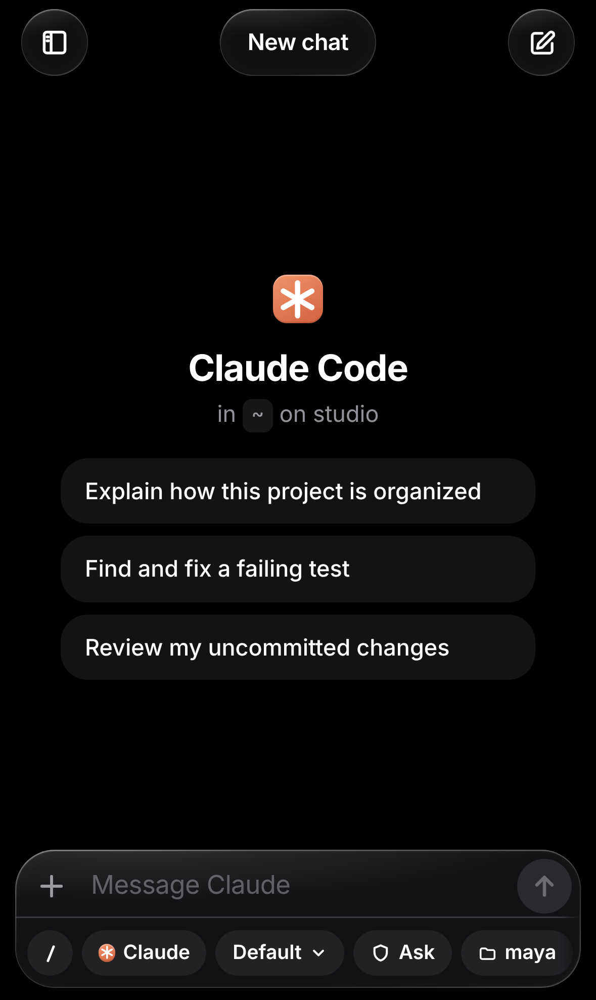
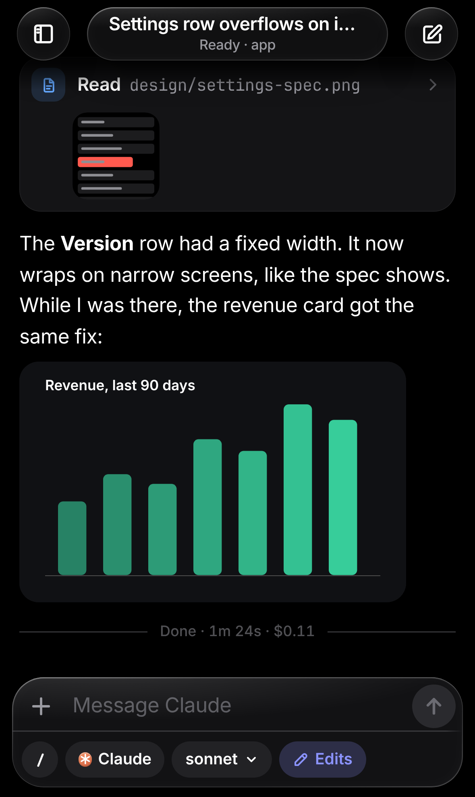
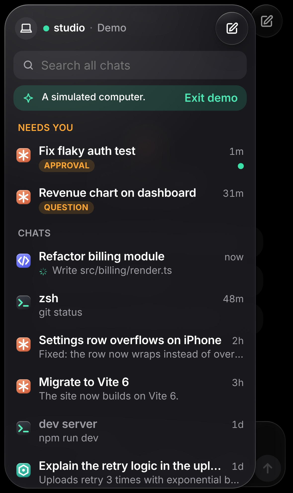
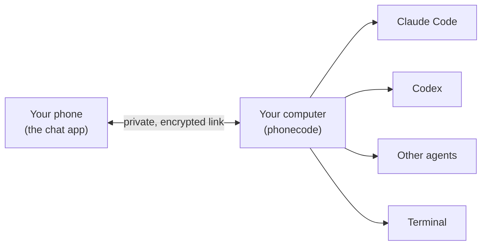

# phone-code

Use Claude Code, Codex and other coding agents from your phone, as a simple chat app. Free and open source.

The agents keep running on your own computer. Your phone is just the screen.

<p align="center">
  
  
  
</p>

## Get started

**1. Install it on your computer** (Mac or Linux). Paste this into a terminal; on a Mac it asks whether you want the command, [the Mac app](#mac-app-and-updates) or both:

```sh
curl -fsSL https://raw.githubusercontent.com/SloanBDavis/phone-code/main/install.sh | sh
```

**2. Start it.**

```sh
phonecode
```

A QR code appears. If it does not, phone-code tells you why and what to do; see [Connecting your phone](#connecting-your-phone).

**3. Scan the QR code with your phone's camera.** The app opens. On an iPhone, tap Share, then "Add to Home Screen" to keep it like a normal app.

That's it. Type a message and send.

> You need at least one coding agent installed and signed in on the computer first, for example [Claude Code](https://claude.com/claude-code). phone-code uses the agents you already have, with your own accounts.

## How it works



There is no phone-code account and no phone-code server. Your code and your chats stay on your computer.

## Connecting your phone

Your phone has to be able to reach your computer. Pick one:

|                             | Works        | Encrypted | What to do                                                                                                                                                                                 |
| --------------------------- | ------------ | --------- | ------------------------------------------------------------------------------------------------------------------------------------------------------------------------------------------ |
| **Tailscale** (recommended) | Anywhere     | Yes       | Install [Tailscale](https://tailscale.com/download) on the computer and the phone, sign in to both, then run `phonecode setup` once; it walks you through the one-time Tailscale settings. |
| **Same Wi-Fi**              | Only at home | No        | Run `phonecode --insecure`. Fine to try it out on a network you trust. No notifications.                                                                                                   |

Not sure which applies, or something is not working? Run:

```sh
phonecode setup
```

It checks your computer and tells you the one next step.

## What you can do

- Chat with any agent on your computer: pick the agent, model and mode on the bar, then send.
- Approve or deny what the agent wants to do with one tap.
- See diffs, command output and images the way a phone should show them.
- Send photos and screenshots to the agent.
- Find and continue any past chat, including ones you started at the computer.
- Open a real terminal when you need one.
- Follow chats from the Cursor desktop app and reply when a turn ends.

Works with Claude Code, Codex, Antigravity, Gemini CLI, OpenCode and other agents that speak the Agent Client Protocol. Claude Code is the most tested; see [which agents work how well](docs/guide.md#agent-support).

Want to look before installing? The app has a built-in demo: tap "Try the demo" on its first screen.

## Mac app and updates

On a Mac with Apple silicon and macOS 26 or newer, the install command in step 1 asks what you want:

1. Both the `phonecode` command and the Mac app
2. The `phonecode` command only
3. The Mac app only

The Mac app is a native window onto the same chats, with a tiled workspace that shows several at once. It has its own `phonecode` inside, so choosing only the app is enough, and it finds a `phonecode` that is already running on that Mac by itself. There is a native iPhone app too, which you build yourself with Xcode: see [apple/README.md](apple/README.md).

To update:

- **The command:** `phonecode update`. When a newer version is out, `phonecode` also offers it when you start it.
- **The Mac app:** it tells you when it opens, or choose **PhoneCode > Check for Updates…**. It downloads the new version and reopens.

## More

- [Mac and iPhone app](apple/README.md): building the native apps from source
- [Guide](docs/guide.md): all commands and options, connection details, features, agent support, how it is built
- [Security](SECURITY.md): what is protected, what is not, and what has been formally checked
- [Contributing](CONTRIBUTING.md): building from source and running the tests
- [Protocol](docs/protocol.md): how the phone and the computer talk

MIT licensed.
