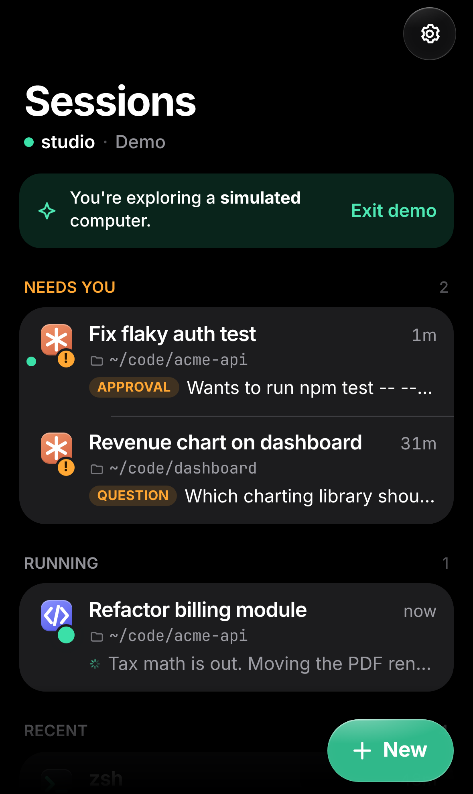
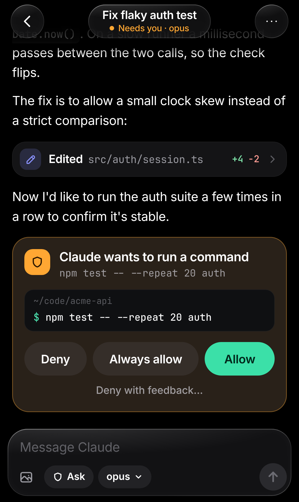
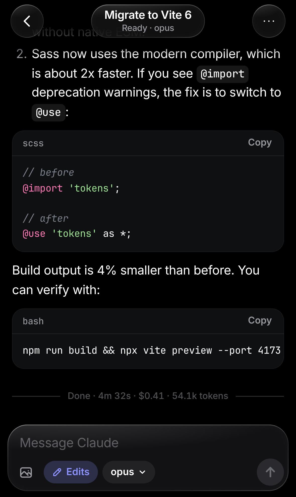
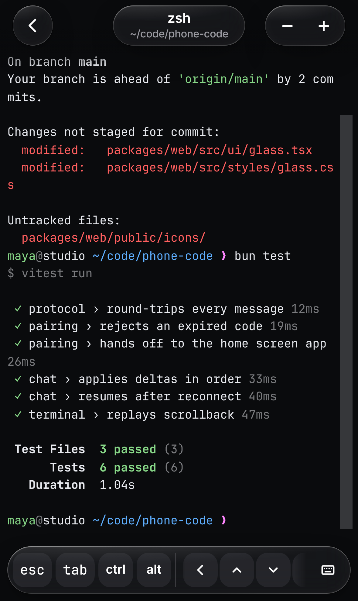
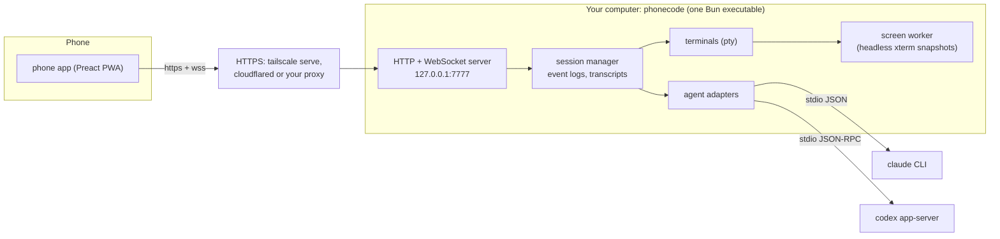

# phone-code

Your dev machine in your pocket. Free and open source (MIT).

Run one command on your computer, scan the QR code with your phone, and you get a real terminal plus Claude Code, Codex and any ACP agent (Antigravity, Gemini CLI, OpenCode, ...) as a chat app built for a phone screen: tool calls, diffs and permission prompts rendered as native-feeling UI instead of a TUI squeezed into a tiny terminal.

<p align="center">
  <picture>
    <source media="(prefers-color-scheme: light)" srcset="docs/screenshots/sessions-light.png">
    
  </picture>
</p>

<p align="center">
  
  
  
</p>

<p align="center"><sub>Screenshots from the built-in demo (<code>/?demo=1</code>), regenerated with <code>bun run screenshots</code>. Light versions are in <a href="docs/screenshots">docs/screenshots</a>.</sub></p>

phone-code is two pieces:

- **`phonecode`**, a single executable you run on your Mac or Linux machine. It serves the phone app, pairs devices with a QR code, runs terminals and drives the agent CLIs you already have installed and logged in.
- **The phone app**, a web app you add to your Home Screen. It talks only to your computer; there is no phone-code server or account.

## Status

Early and moving fast (v0.1.0). Claude Code support is verified against the real CLI; other parts are newer and less tested (see [Agent support](#agent-support)). No release has been published yet, so for now [build from source](#build-from-source).

## Install

Prebuilt binaries for macOS and Linux (arm64 and x64) are built by the release workflow and attached to [GitHub Releases](https://github.com/SloanBDavis/phone-code/releases).

```sh
curl -fsSL https://raw.githubusercontent.com/SloanBDavis/phone-code/main/install.sh | sh
```

The script picks the binary for your OS and CPU, checks it against the release's `SHA256SUMS`, and installs `phonecode` to `~/.local/bin` (set `PHONECODE_INSTALL` to change that, `PHONECODE_VERSION=v0.1.0` to pin a version). Read it first if you like: [install.sh](install.sh).

Or through npm, which downloads only the binary for your platform:

```sh
npx phone-code        # or: bunx phone-code
npm install -g phone-code
```

The binary is large (about 90 to 110 MB, 45 to 55 MB compressed) because it contains the Bun runtime and the whole phone app. Nothing else is needed at runtime.

### Build from source

Needs [Bun](https://bun.sh) 1.4 or newer.

```sh
git clone https://github.com/SloanBDavis/phone-code && cd phone-code
bun install
bun run build                 # -> packages/daemon/dist/phonecode
./packages/daemon/dist/phonecode
```

## Quick start

1. Install the agents you want to use (`claude` for Claude Code, `codex` for Codex) and log in to them once on the computer. phone-code uses them as they are, with your accounts and settings.
2. Set up a secure address your phone can reach. The easiest is [Tailscale](https://tailscale.com) on the computer and the phone, with [HTTPS certificates enabled](https://tailscale.com/kb/1153/enabling-https) for your tailnet. See [How the connection works](#how-the-connection-works) for the other options.
3. Run `phonecode`. It prints a QR code.
4. Scan it with the phone's camera. The app opens and pairs; on an iPhone it then offers to add itself to the Home Screen.

Press Enter in the `phonecode` window for a fresh pairing code. Pairing codes expire after 5 minutes and work once.

```
phonecode                  start the daemon and show a pairing QR code
phonecode pair             show a fresh pairing QR code (daemon must be running)
phonecode devices          list paired devices
phonecode revoke <id>      revoke a paired device (id or unique prefix)
```

Options: `--port <n>` (default 7777), `--url <https url>`, `--tunnel`, `--local`, `--insecure`, `--host <addr>`, `--no-qr`. Run `phonecode --help` for details. State (paired devices, session transcripts, push keys) lives in `~/.phonecode`, or `$PHONECODE_HOME`.

Want to look around first? Open the app with `/?demo=1` (or tap "Try the demo" on the pairing screen): a simulated computer with scripted agents and a fake shell, running entirely in the browser.

## How the connection works

`phonecode` listens on `127.0.0.1` only. It never serves plain HTTP to the network unless you pass `--insecure`, because the pairing code, your device token and everything in your terminal would cross the network readable by anyone on it. To reach your phone it puts an HTTPS proxy in front of that loopback port, chosen in this order:

| How                       | When                                                                                                                                                                                      | Who can reach it                                                                                                               |
| ------------------------- | ----------------------------------------------------------------------------------------------------------------------------------------------------------------------------------------- | ------------------------------------------------------------------------------------------------------------------------------ |
| `--url https://your.host` | You run your own reverse proxy (Caddy, nginx, ...) to `localhost:<port>`.                                                                                                                 | Whoever can reach your proxy.                                                                                                  |
| `--tunnel`                | Opt in only. Starts a [Cloudflare quick tunnel](https://developers.cloudflare.com/cloudflare-one/connections/connect-networks/do-more-with-tunnels/trycloudflare/) (needs `cloudflared`). | **Anyone on the internet** who has the random `*.trycloudflare.com` URL. Cloudflare terminates TLS, so it can see the traffic. |
| Tailscale (automatic)     | Tailscale is running and HTTPS is enabled for your tailnet. phonecode runs `tailscale serve` for you and removes it on exit.                                                              | Only devices in your tailnet. A real certificate for `<machine>.<tailnet>.ts.net`; TLS ends on your computer.                  |
| Nothing found             | Default fallback.                                                                                                                                                                         | This computer only. phonecode prints the options above instead of a QR code.                                                   |

`--local` skips the Tailscale step. `--insecure` serves plain HTTP on your LAN (binding `0.0.0.0` unless `--host` says otherwise) and prints a large warning; use it only on a network you trust completely, and prefer one of the HTTPS options.

In every mode the HTTPS address only gets you to the pairing screen. Using the app needs a device token, which you only get by redeeming a pairing code from the QR.

The Tailscale integration follows Tailscale's documented `serve` command but has not been tested against a real tailnet yet. Please [open an issue](https://github.com/SloanBDavis/phone-code/issues) if it does not work for you.

## Add to Home Screen

The app is a PWA. Installed, it runs full screen, keeps you signed in, and can receive notifications.

- **iPhone and iPad (Safari):** after pairing, the app shows how: Share, then "Add to Home Screen". iOS gives Home Screen apps storage separate from Safari, so phone-code passes a short-lived, single-use handoff code to the installed app and you do not have to scan again.
- **Android (Chrome):** menu, then "Install app" or "Add to Home screen".

Notifications (Settings, Notifications) tell you when an agent finishes a turn or needs your approval. On iPhone they work only in the Home Screen app (iOS 16.4 or newer).

## Features

- **Sessions list** grouped into "Needs you", "Running" and "Recent", with unread markers, live previews, swipe to rename or delete.
- **Agent chat** for Claude Code and Codex: streaming Markdown with syntax-highlighted code, thinking, and tool calls shown natively (commands with output, file edits as diffs, reads, searches, web fetches, todo lists, sub-agents).
- **Approvals and questions:** allow, always allow, or deny with feedback; multiple-choice questions from the agent as tappable options.
- **Controls:** permission mode (Ask before acting, Accept edits, Plan only, Bypass permissions), model switch, interrupt, photo attachments.
- **Resume** past Claude Code and Codex sessions found on the computer, in the folder you pick.
- **Terminal:** a real login shell in a pty, xterm.js rendering, a key bar (esc, tab, sticky ctrl and alt, arrows), adjustable font size.
- **Reconnects cleanly:** missed chat events and terminal output are replayed after a dropped connection; sessions and transcripts survive a daemon restart (running terminals do not).
- **Several devices** can pair; list and revoke them with `phonecode devices` / `phonecode revoke`, or unpair from the phone.
- **Light and dark** themes, Liquid Glass-style UI, built for one-handed use.

## Agent support

| Agent                                                          | Status       | Notes                                                                                                                                                                                                                        |
| -------------------------------------------------------------- | ------------ | ---------------------------------------------------------------------------------------------------------------------------------------------------------------------------------------------------------------------------- |
| Claude Code (`claude`)                                         | Works        | Verified against the real CLI. phone-code speaks the CLI's stream-json control protocol directly (the same one the Agent SDK uses), so permissions, modes, models, interrupts and resume map one to one.                     |
| Codex (`codex`)                                                | Experimental | Implemented against the `codex app-server` JSON-RPC schema. Exercised against the real binary only up to login; full model turns have not been run yet, so expect rough edges and please report them.                        |
| Antigravity (`agy`)                                            | Experimental | Runs through Antigravity's own ACP server (`agy acp`). Exercised against the real CLI 1.5.13 with a scripted model endpoint; no real Google model turn or login has been run.                                                |
| Gemini CLI, OpenCode, Qwen Code (ACP)                          | Experimental | Generic [Agent Client Protocol](https://github.com/agentclientprotocol/agent-client-protocol) adapter. Handshake, login path, modes and models checked against the real CLIs; full model turns only against a scripted fake. |
| Goose, Kimi, Copilot, Cursor, Auggie, Cline, Qoder, Vibe (ACP) | Untested     | Presets taken from the ACP registry; never run.                                                                                                                                                                              |
| Any other ACP agent                                            | Experimental | Add it to `agents.json` in the state directory: `{"agents":[{"id":"my-agent","name":"My Agent","command":"my-agent","args":["acp"]}]}`. Read at daemon start.                                                                |

The terminal works with anything, so you can always run an agent's own TUI there.

## Architecture



- **`packages/daemon`**: the `phonecode` CLI and daemon. Bun-native: `Bun.serve` for HTTP and WebSockets, `Bun.spawn` with a pty for terminals, a worker thread running headless xterm.js to produce terminal snapshots. Built with `bun build --compile` into one executable with the web app embedded (brotli-precompressed).
- **`packages/web`**: the phone app. Preact with signals, Vite, xterm.js, marked and highlight.js loaded on demand. About 53 kB gzipped for the first screen.
- **`packages/protocol`**: TypeScript types for the WebSocket protocol, shared by both sides. See [docs/protocol.md](docs/protocol.md).
- **`e2e`**: Playwright tests that drive the real daemon with scripted fake `claude` and `codex` binaries.
- **`formal`**: TLA+ models of the chat sync and pairing protocols, checked with TLC, and a Tamarin model of pairing and authentication against a network attacker.

## Security

Pairing a phone gives it a shell on your computer as your user, and agents that can run commands. Treat a paired phone like an unlocked laptop.

- The daemon binds loopback and refuses unencrypted connections from the network unless you pass `--insecure`.
- Pairing codes are single use and expire after 5 minutes. The QR link carries a 128-bit secret; the 10-character code you can type instead (about 49 bits) is rate limited, and that limit cannot block the QR link.
- Revoking a device also revokes the devices paired through it, such as its Home Screen app.
- Each device gets a random 256-bit token. The daemon stores only its SHA-256 hash; revoke a device any time.
- On the phone the token is stored in the app's local storage. Anyone who can open the app on your unlocked phone can use your computer.
- `--tunnel` makes the pairing screen reachable from the whole internet and lets Cloudflare see your traffic.
- Session transcripts are stored unencrypted in `~/.phonecode` (directory mode 0700, files 0600).

Read [SECURITY.md](SECURITY.md) for the full model, its limits, and how to report a vulnerability.

## Development

```sh
bun install            # also installs git hooks (lefthook), except in CI
bun run dev            # daemon from source on :7777, serving the last web build
bun run --filter @phone-code/web dev   # Vite on :5173; open /?demo=1 (no daemon behind it)
bun run check          # format check, oxlint (type-aware), typecheck, knip, protocol doc
bun run build          # web app + packages/daemon/dist/phonecode
bun run e2e            # Playwright end-to-end suite
bash formal/check.sh   # TLA+ model checking (needs Java)
bun run release        # cross-compile all targets into release/
bun run screenshots    # regenerate docs/screenshots from the demo
```

`PHONECODE_ECHO_AGENT=1` replaces the real agents with a built-in fake, handy when working on the UI. See [CONTRIBUTING.md](CONTRIBUTING.md) for the rest.

## Roadmap

- A native iOS app with real Liquid Glass components, using the same daemon and protocol.
- Codex verified end to end against real model turns.
- More agents through the Agent Client Protocol.
- A first tagged release with binaries and the npm package.

## License

[MIT](LICENSE)
