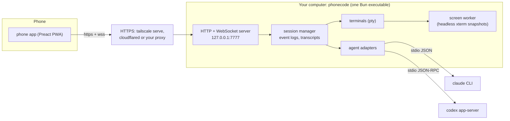

# phone-code guide

Everything beyond the three steps in the [README](../README.md).

## Commands

```
phonecode                  start and show a pairing QR code
phonecode setup            check your connection options and say what to do next
phonecode pair             show a fresh pairing QR code (phonecode must be running)
phonecode devices          list paired phones
phonecode revoke <id>      remove a paired phone
phonecode cursor connect   follow Cursor desktop chats (see "Cursor desktop app")
phonecode cursor disconnect
phonecode cursor status
phonecode update            install the latest version
```

Options: `--port <n>` (default 7777, or `$PHONECODE_PORT`), `--url <https url>`, `--tunnel`, `--local`, `--insecure`, `--host <addr>`, `--no-qr`. Run `phonecode --help` for details. State (paired devices, chats, images, push keys) lives in `~/.phonecode`, or `$PHONECODE_HOME`.

Pairing codes expire after 5 minutes and work once. Press Enter in the `phonecode` window for a fresh one.

## Install options

The install script picks the binary for your OS and CPU, checks it against the release's `SHA256SUMS`, and installs `phonecode` to `~/.local/bin` (set `PHONECODE_INSTALL` to change that, `PHONECODE_VERSION=v0.1.0` to pin a version). Read it first if you like: [install.sh](../install.sh).

On a Mac that can run the Mac app (Apple silicon, macOS 26 or newer) the script asks whether to install the command, the app or both. To skip the question, add `-s -- --cli`, `-s -- --app` or `-s -- --all` after `sh`. Anywhere else, and when there is no terminal to ask on, it installs the command.

### Updates

`phonecode update` installs the latest release over the `phonecode` you are running, with the same script. When you start `phonecode` at a terminal it looks for a newer release (at most once every 12 hours, by asking github.com where its latest release is) and offers to install it; say no and it only mentions it from then on. `PHONECODE_NO_UPDATE_CHECK=1` turns the check off. A `phonecode` installed with npm, built from source or inside the Mac app is not replaced this way; it tells you how to update instead. The Mac app updates itself from **PhoneCode > Check for Updates…**.

The binary is large (about 90 to 110 MB) because it contains the Bun runtime and the whole phone app. Nothing else is needed at runtime.

### Build from source

Needs [Bun](https://bun.sh) 1.4 or newer.

```sh
git clone https://github.com/SloanBDavis/phone-code && cd phone-code
bun install
bun run build                 # -> packages/daemon/dist/phonecode
./packages/daemon/dist/phonecode
```

## How the connection works

`phonecode` listens on `127.0.0.1` only. It never serves plain HTTP to the network unless you pass `--insecure`, because the pairing code, your device token and everything in your terminal would cross the network readable by anyone on it. To reach your phone it puts an HTTPS proxy in front of that loopback port, chosen in this order:

| How                       | When                                                                                                                                                                                      | Who can reach it                                                                                                               |
| ------------------------- | ----------------------------------------------------------------------------------------------------------------------------------------------------------------------------------------- | ------------------------------------------------------------------------------------------------------------------------------ |
| `--url https://your.host` | You run your own reverse proxy (Caddy, nginx, ...) to `localhost:<port>`.                                                                                                                 | Whoever can reach your proxy.                                                                                                  |
| `--tunnel`                | Opt in only. Starts a [Cloudflare quick tunnel](https://developers.cloudflare.com/cloudflare-one/connections/connect-networks/do-more-with-tunnels/trycloudflare/) (needs `cloudflared`). | **Anyone on the internet** who has the random `*.trycloudflare.com` URL. Cloudflare terminates TLS, so it can see the traffic. |
| Tailscale (automatic)     | Tailscale is running and HTTPS is enabled for your tailnet. phonecode runs `tailscale serve` for you and removes it on exit.                                                              | Only devices in your tailnet. A real certificate for `<machine>.<tailnet>.ts.net`; TLS ends on your computer.                  |
| Nothing found             | Default fallback.                                                                                                                                                                         | This computer only. phonecode prints the options above instead of a QR code.                                                   |

`--local` skips the Tailscale step. `--insecure` serves plain HTTP on your LAN (binding `0.0.0.0` unless `--host` says otherwise) and prints a large warning; use it only on a network you trust completely, and prefer one of the HTTPS options.

In every mode the HTTPS address only gets you to the pairing screen. Using the app needs a device token, which you only get by redeeming a pairing code from the QR.

The Tailscale integration follows Tailscale's documented `serve` command but has not been tested against a real tailnet yet. Please [open an issue](https://github.com/SloanBDavis/phone-code/issues) if it does not work for you.

## Add to Home Screen

The app is a PWA. Installed, it runs full screen, keeps you signed in, and can receive notifications.

- **iPhone and iPad (Safari):** after pairing, the app shows how: Share, then "Add to Home Screen". iOS gives Home Screen apps storage separate from Safari, so phone-code passes a short-lived, single-use handoff code to the installed app and you do not have to scan again.
- **Android (Chrome):** menu, then "Install app" or "Add to Home screen".

Notifications (Settings, Notifications) tell you when an agent finishes a turn or needs your approval. On iPhone they work only in the Home Screen app (iOS 16.4 or newer).

## Features

- **One chat screen.** Pick the agent, model, mode and folder on the bar and send. The chat is created when you send.
- **Sidebar of chats** with "Needs you" first. Swipe to archive (it only leaves the sidebar); long-press to rename or delete.
- **Search all chats** from every agent, including ones you started at the computer and archived ones. Opening one brings it back to the sidebar.
- **Agent chat:** streaming Markdown with highlighted code, thinking, and tool calls shown natively (commands with output, file edits as diffs, reads, searches, todo lists, sub-agents).
- **Approvals and questions:** allow, always allow, or deny with feedback; multiple-choice questions as tappable options.
- **Slash commands:** type `/` to see what the agent offers.
- **Images:** send photos from the library, camera or clipboard; view images the agent reads or produces, full screen with zoom.
- **Terminal:** a real login shell, with a key bar (esc, tab, sticky ctrl and alt, arrows) and adjustable text size.
- **Reconnects cleanly:** missed output is replayed after a dropped connection; chats survive a restart of `phonecode` (running terminals do not).
- **Several phones** can pair; list and remove them with `phonecode devices` / `phonecode revoke`, or unpair from the phone.
- **Sub-agents:** each one is a compact card in the chat (what it is doing now, then its report), and the ones at work are named above the message box. Tap either to watch it, or to read every step it took. Claude Code, Codex and Antigravity.
- **Keyboard:** everything works from the keyboard, with shortcuts for the rest; press ⌘/ (Ctrl+/) for the list. The Mac app's menus have them too.
- **Light and dark** themes, built for one-handed use.

## Agent support

| Agent                                                          | Status       | Notes                                                                                                                                                                                                                          |
| -------------------------------------------------------------- | ------------ | ------------------------------------------------------------------------------------------------------------------------------------------------------------------------------------------------------------------------------ |
| Claude Code (`claude`)                                         | Works        | Verified against the real CLI. phone-code speaks the CLI's stream-json control protocol directly (the same one the Agent SDK uses), so permissions, modes, models, interrupts and resume map one to one.                       |
| Codex (`codex`)                                                | Experimental | Implemented against the `codex app-server` JSON-RPC schema. Exercised against the real binary only up to login; full model turns have not been run yet, so expect rough edges and please report them.                          |
| Antigravity (`agy`)                                            | Works        | Runs through Antigravity's own ACP server (`agy acp`). Verified against the real CLI 1.5.18 with real model turns: edits, commands, approvals, Plan mode, its plans and walkthroughs, search. See [Antigravity](#antigravity). |
| Gemini CLI, OpenCode, Qwen Code (ACP)                          | Experimental | Generic [Agent Client Protocol](https://github.com/agentclientprotocol/agent-client-protocol) adapter. Handshake, login path, modes and models checked against the real CLIs; full model turns only against a scripted fake.   |
| Goose, Kimi, Copilot, Cursor, Auggie, Cline, Qoder, Vibe (ACP) | Untested     | Presets taken from the ACP registry; never run.                                                                                                                                                                                |
| Any other ACP agent                                            | Experimental | Add it to `agents.json` in the state directory: `{"agents":[{"id":"my-agent","name":"My Agent","command":"my-agent","args":["acp"]}]}`. Read at daemon start.                                                                  |

The terminal works with anything, so you can always run an agent's own TUI there.

### Antigravity

Install the [Antigravity CLI](https://github.com/google-antigravity/antigravity-cli) (`agy`) and sign in once on the computer (run `agy`); phone-code finds it on your PATH or in `~/.local/bin`.

- **Pick on the bar:** its models (Gemini, Claude, GPT-OSS), its thinking level (Low to Extra), and its modes: Ask before acting, Accept edits, Plan only, Auto (safe actions go ahead, risky ones ask) and Bypass permissions. Its slash commands (`/goal`, `/browser`, `/compact`, `/schedule`, …) are in the `/` menu. A new chat offers all of these even before your first Antigravity chat from phone-code: phone-code reopens your latest Antigravity conversation in the background to read them, without changing it.
- **Plans and walkthroughs:** what Antigravity writes for you to read (an implementation plan, a task list, a walkthrough) is a card in the chat. Tap it, or a link to it in the answer, to read it full screen. A plan that waits for your review has a **Proceed** button; to change it instead, just reply.
- **Search:** "All chats" searches the text of every Antigravity conversation, including the ones you had at the computer, and continues any of them.
- **Images** you attach are sent to it; screenshots and images it links to from its artifact folder are shown in the chat.

Its approvals offer Allow and Deny only (Antigravity has no "always allow").

### Cursor desktop app

Chats you run in the Cursor app on your computer can show up on your phone, so you can follow along and reply when a turn ends.

- **Connect:** turn on "Follow Cursor chats" in Settings (the app suggests it when Cursor is installed), or run `phonecode cursor connect`. This adds phone-code's hooks to `~/.cursor/hooks.json`, next to any hooks you already have, and installs a small script in phone-code's state folder.
- **Follow along:** like a chat you started at the computer with any other agent, a Cursor chat is in "All chats" (search, or browse), not in the sidebar; open it to see the prompt, thinking, commands, edits and the answer live. Once opened it stays in the sidebar like any chat. A Cursor chat that waits for your reply shows under "Needs you" by itself, and only that sends a notification: turns that just finish in Cursor do not.
- **Reply:** Cursor only takes a message from phone-code at the moment a turn ends, so there are two ways to reply:
  - While Cursor is working, send a message and it goes out when the turn ends.
  - When a turn ends, Cursor waits for your reply (the chat says "Waiting for your reply" and you get a notification) if the chat is open on your phone, or if nobody is at the computer: no keyboard or mouse input for two minutes (macOS only). It waits up to 8 hours. In Cursor the turn looks unfinished meanwhile; it is let go as soon as someone uses the computer again and the chat is not open on a phone.
  - Otherwise the chat says "Continue in Cursor" and takes no message: send the next one from Cursor, and you can reply from the phone when that turn ends.
- **Disconnect:** turn the setting off, or run `phonecode cursor disconnect`. Only phone-code's hooks are removed.

When phone-code is not running, the hooks answer at once and Cursor works as usual. You can't start a Cursor chat from your phone, approve Cursor's tool calls, or change its model; Cursor's hooks don't allow it.

## Architecture



- **`packages/daemon`**: the `phonecode` CLI and daemon. Bun-native: `Bun.serve` for HTTP and WebSockets, `Bun.spawn` with a pty for terminals, a worker thread running headless xterm.js to produce terminal snapshots. Built with `bun build --compile` into one executable with the web app embedded (brotli-precompressed).
- **`packages/web`**: the phone app. Preact with signals, Vite, xterm.js, marked and highlight.js loaded on demand. About 53 kB gzipped for the first screen.
- **`packages/protocol`**: TypeScript types for the WebSocket protocol, shared by both sides. See [docs/protocol.md](protocol.md).
- **`e2e`**: Playwright tests that drive the real daemon with scripted fake `claude` and `codex` binaries.
- **`formal`**: TLA+ models of the chat sync and pairing protocols, checked with TLC, and a Tamarin model of pairing and authentication against a network attacker.

## Security

Pairing a phone gives it a shell on your computer as your user, and agents that can run commands. Treat a paired phone like an unlocked laptop.

- The daemon binds loopback and refuses unencrypted connections from the network unless you pass `--insecure`.
- Pairing codes are single use and expire after 5 minutes. The QR link carries a 128-bit secret; the 10-character code you can type instead (about 49 bits) is rate limited, and that limit cannot block the QR link.
- Revoking a device also revokes the devices paired through it, such as its Home Screen app.
- Each device gets a random 256-bit token. The daemon stores only its SHA-256 hash; revoke a device any time.
- On the phone the token is stored in the app's local storage. Anyone who can open the app on your unlocked phone can use your computer.
- `--tunnel` makes the pairing screen reachable from the whole internet and lets Cloudflare see your traffic.
- Session transcripts are stored unencrypted in `~/.phonecode` (directory mode 0700, files 0600).

Read [SECURITY.md](../SECURITY.md) for the full model, its limits, and how to report a vulnerability.

## Development

```sh
bun install            # also installs git hooks (lefthook), except in CI
bun run dev            # daemon from source on :7777, serving the last web build
bun run --filter @phone-code/web dev   # Vite on :5173; open /?demo=1 (no daemon behind it)
bun run check          # format check, oxlint (type-aware), typecheck, knip, protocol doc
bun run build          # web app + packages/daemon/dist/phonecode
bun run e2e            # Playwright end-to-end suite
bash formal/check.sh   # TLA+ model checking (needs Java)
bun run release        # cross-compile all targets into release/
bun run screenshots    # regenerate docs/screenshots from the demo
```

`PHONECODE_ECHO_AGENT=1` replaces the real agents with a built-in fake, handy when working on the UI. See [CONTRIBUTING.md](../CONTRIBUTING.md) for the rest.

## Roadmap

- A native iOS app with real Liquid Glass components, using the same daemon and protocol.
- Codex verified end to end against real model turns.
- More agents through the Agent Client Protocol.
- A first tagged release with binaries and the npm package.

## License

[MIT](../LICENSE)
